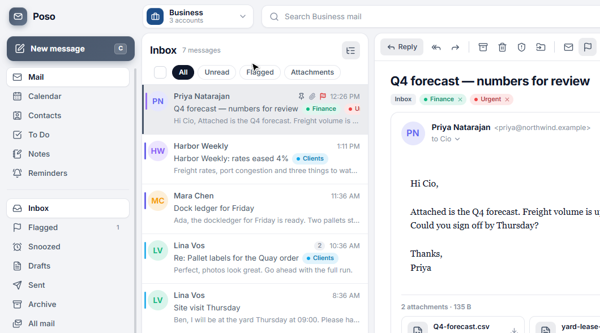

<div align="center">
  

  <h1>Poso</h1>

  <p><strong>A desktop mail client that keeps business and personal inboxes in separate sessions.</strong></p>

  <p>
    <a href="LICENSE"></a>
    <a href="https://ktsoaela.github.io/poso/"></a>
    <a href="docs/guide.md"></a>
    
  </p>
</div>

**Author:** [Khotso Tsoaela](https://github.com/ktsoaela) (`@ktsoaela`)

---

**[See all features →](https://ktsoaela.github.io/poso/)**

**Poso** — post, in Sesotho — is a Windows mail client with a quiet three-pane window. One click swaps the whole workspace between work addresses and personal addresses. Search, spam, and the compose From menu stay inside the session you picked.

Mail is synced over IMAP and sent over SMTP, including Gmail and Outlook accounts that sign in through the browser. The UI runs in an Electron window. A FastAPI engine on your machine stores mail in SQLite and keeps passwords in Windows Credential Manager.

The page is [`docs/index.html`](docs/index.html). It goes live when GitHub Pages is set to the `docs` folder on the default branch.

A [GitHub release](https://github.com/ktsoaela/poso/releases) is the download page, not a store listing. Attach `Poso.Setup.exe`, `Poso.apk`, and `Poso.AppImage` to the latest release and the buttons on the page download those files. Only the Windows installer is built so far: `desktop\release-poso\Poso Setup 1.0.0.exe`. Where that mailbox is stored is in the [guide](docs/guide.md).



---

## Why Poso

- **Sessions** split business addresses (x, y, z) and personal addresses (1, 2) into workspaces. Switch from the header dropdown or with `Ctrl+1`…`Ctrl+9`.
- **One list** shows every account in the active session. A colored bar on each row shows which address received the mail.
- **Rich mail** renders the sender's HTML, CSS and inline images in a sandboxed frame. Remote images stay blocked until you load them.
- **Spam** combines provider junk folders, a blocklist, and a local Bayesian filter trained from the mail you mark.

## Features

| Area | What you get |
| --- | --- |
| Layout | Header with session switcher, search and settings. Sidebar with folders, labels and accounts. Status footer with engine state, sync time and version. Light/dark themes, 7 accents, comfortable/compact density. Reading pane on the right, at the bottom, or off. |
| Reading | Conversation view, sandboxed HTML/CSS, `cid:` inline images, attachment cards, plain-text toggle, full headers, print, save as `.eml` |
| Organising | Labels (Outlook categories), flag, pin to top, snooze, archive, move, bulk select with hover actions, Undo on archive/delete |
| Search | Full-text search plus `from:` `to:` `subject:` `has:attachment` `is:unread` `is:flagged` `label:` `in:` `account:` `before:` `after:` `newer:7d`, across all folders or the current one |
| Writing | Rich text editor, per-account HTML signatures, contact autocomplete, Cc/Bcc, drag-and-drop attachments, inline images, high priority, read receipts, undo send, scheduled send, auto-saved drafts |
| Rules | Outlook/Thunderbird-style rules (from/to/subject/body/account → label, read, flag, archive, spam, delete). They run on new mail and on demand. |
| Data | Export to MBOX, EML (zip), JSON backup or contacts CSV. Import `.eml`, `.mbox` (Thunderbird, Apple Mail, Google Takeout) or zips of `.eml`. Restore backups. |
| Audit | Append-only log of sign-ins, sends, moves, deletes, spam decisions, rules, imports, exports and settings changes, with filtering and CSV/JSON export |
| Productivity | Command palette (`Ctrl+K`), Gmail-style shortcuts (`?` lists them), desktop notifications |
| Organizer | Calendar (month grid, agenda, event alerts), Contacts (feed compose autocomplete, import from mail), To Do (My day / Important / Planned, due-time alerts), Notes (autosave, pin, colors) and Reminders (repeat, snooze). Each belongs to the active session. Switch with `Alt+1`…`Alt+6`. |
| Notifications | Native Electron notifications for new mail, reminders, event alerts and due to-dos, using the Poso logo. Clicking one opens the item. Alerts that come due while Poso is closed show on the next launch. |

## Quick start

**Requirements:** Python 3.11 or newer, Node.js 20 or newer. Rust with the MSVC toolchain is only needed if you build the optional Tauri installer.

```powershell
.\scripts\dev.ps1
```

The script opens the engine in another window and serves the UI at http://localhost:1420. On the first screen, connect a real address. **Explore with sample mail** is optional; remove it later from Settings → Accounts without affecting real accounts or their audit history.

| Goal | Command |
| --- | --- |
| Run Poso | `.\scripts\dev.ps1` → http://localhost:1420 |
| Engine tests | `cd engine; .\.venv\Scripts\python.exe -m pytest` |
| Desktop window | `.\scripts\electron.ps1` |
| Windows installer | `cd desktop; npm run pack` → `desktop\release-poso\Poso Setup 1.0.0.exe`, published as `Poso.Setup.exe` |

## Layout

| Path | What it is |
| --- | --- |
| `engine/` | FastAPI mail engine: accounts, IMAP sync, SMTP, search, spam |
| `desktop/` | Electron shell and React UI |
| `mobile/` | Flutter app for Android. Offline-first, syncs IMAP itself. See `mobile/README.md` |
| `docs/index.html` | GitHub Pages landing page: every feature |
| `docs/guide.md` | Sessions, sign-in, spam, shortcuts, and the installer |
| `scripts/` | Dev server, sidecar launcher, and Windows build |

## Stack

| Layer | Choice |
| --- | --- |
| Window | Electron |
| UI | React, TypeScript, Vite, Tailwind |
| Engine | FastAPI |
| Mail | IMAP, SMTP, XOAUTH2 |
| Storage | SQLite, Windows Credential Manager |

---

## Documentation map

| Doc | Purpose |
| --- | --- |
| [See all features](https://ktsoaela.github.io/poso/) | The landing page, once Pages serves the `docs` folder |
| [Guide](docs/guide.md) | Accounts, where the mailbox is stored, sign-in, spam, shortcuts, and the Windows build |

---

## License

MIT. Copyright 2026 Poso.
